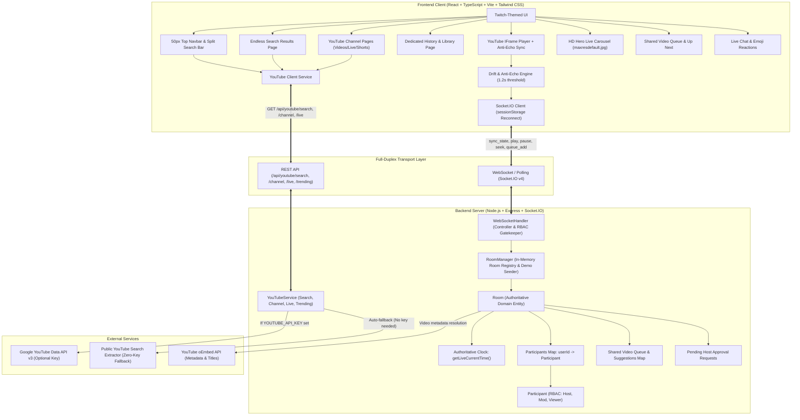

# WatchSync — YouTube Watch Party System

> Production-ready, real-time synchronized YouTube Watch Party system styled in an authentic Twitch dark theme, featuring authoritative server-side Role-Based Access Control (RBAC), anti-echo loop protection, sub-second drift compensation, an action approval workflow, and dual-strategy real-time YouTube Data API & direct search.

---

## 🌐 Live Deployments

- **Frontend Live Application**: [https://web3-task-mu.vercel.app/](https://web3-task-mu.vercel.app/)
- **Backend Service URL**: [https://youtube-watch-party-backend-jf3c.onrender.com](https://youtube-watch-party-backend-jf3c.onrender.com)
- **Backend Health Check**: [https://youtube-watch-party-backend-jf3c.onrender.com/api/health](https://youtube-watch-party-backend-jf3c.onrender.com/api/health)

---

## 🚀 Key Highlights & Architectural Strengths

1. **Full YouTube Experience (Search, Channels, Live Streams, Library)**:
   - **YouTube-Style Endless Search Results Page**: Hitting **Enter** in the top search bar opens a dedicated search results page (`?search_query=...`) with infinite scroll (`IntersectionObserver` + `nextPageToken` / InnerTube continuation), duration/`LIVE` badges, filter chips, and 1-click party actions.
   - **Clickable YouTube Channel Pages**: Clicking any channel name or avatar (in Search, Trending, Recommended Channels sidebar, or under the Video Player) opens that channel's full page with banner, avatar, subscriber count, **Videos / Live / Shorts / About** tabs, Latest/Popular sorting, and endless scroll.
   - **Real Live YouTube Streams**: Both the Hero Carousel Theater and the Live Watch Parties shelf pull **currently live streaming videos** from YouTube (`/api/youtube/live`) with crisp HD `maxresdefault.jpg` banners.
   - **Personal Library & Dedicated History Page**: **Subscriptions**, **Watch Later**, **Liked Videos**, and **Recently Watched & History** are persisted in `localStorage` and accessible from the left sidebar in a dedicated `HistoryPage` view without cluttering the Home page.
   - **Dual-Strategy Zero-Key API**: Supports optional `YOUTUBE_API_KEY` (YouTube Data API v3) with an automatic zero-key direct extractor fallback.

2. **Authentic Twitch Dark Theme Design System**:
   - Hand-crafted Twitch design palette: `#0E0E10` (canvas), `#18181B` (cards/nav), `#1F1F23` (surfaces/inputs), `#2F2F35` (hover/borders), and `#9146FF` (signature Twitch purple).
   - **Twitch 3D Card Hover Interaction**: Hovering video thumbnails shifts them `translate(6px, -6px)` revealing an offset solid Twitch purple (`#9146FF`) backdrop underneath.
   - **Twitch Verified Rosette Badges**: Official 8-pointed star rosette SVG badge for verified channels and streamers.
   - **Top 50px Navigation Bar**: Split search bar (`rounded-l-[6px]` input + attached `rounded-r-[6px]` search button), official Twitch Glitch logo SVG, **WatchSync** wordmark, interactive **Notifications** popover, Prime Loot crown, and 8px online status indicator.
   - **Premium Apple/3D Emoji System (`PremiumEmoji.tsx`)**: High-resolution Icons8 3D emoji assets (`img.icons8.com/emoji/96/*.png`) across live floating reactions, stream chat quick-reactions, inline chat messages, an 18-emoji picker popover, and lobby preset chips.
   - **Hero Carousel Showcase Theater**: Dual-pane featured stream preview on the homepage with live stream preview and metadata card.

3. **Object-Oriented Backend Architecture (OOP Bonus)**:
   - Clean domain encapsulation with `Participant`, `Room`, `RoomManager`, `YouTubeService`, and `WebSocketHandler`.
   - Authoritative state storage with `getLiveCurrentTime()` accounting for elapsed real-time playback so late joiners sync with sub-second precision.

4. **Shared Video Queue & Participant Suggestions**:
   - Up Next playlist with real-time YouTube title resolution, Play Now, Reordering, and Auto-Play when current video ends.
   - Participant video suggestion workflow with 1-click Host/Moderator approval.

5. **Strict Server-Side Role-Based Access Control (RBAC)**:
   - Enforces four distinct roles: `Host` (Admin), `Moderator`, `Participant`, and `Viewer`.
   - **Open-Party Mode Toggle**: Host can unlock playback controls so all participants can pause/seek/play together.
   - **Room Lock Controls**: Host can lock room to prevent new participants from joining.

6. **Anti-Echo Loop Protection & Drift Telemetry**:
   - `isProgrammaticUpdateRef` flag prevents infinite ping-pong bounce between YouTube IFrame API events and Socket.IO broadcasts.
   - Drift threshold tolerance (`1.2s`) prevents micro-stutter while ensuring tight synchronization.
   - Real-time telemetry health pill (`● SYNCED • 0.08s drift • 24ms`).
   - Floating live animated emoji reactions (`🔥`, `😂`, `😱`, `💜`, `👏`).
   - Clickable chat timestamps (`@MM:SS`) and global keyboard shortcuts (`Space`, `ArrowLeft/Right`, `M`, `F`, `C`).
   - 15-second server grace period maintains exact roles on brief network drops or page refreshes (`sessionStorage`).

7. **100% Automated E2E Test Suite (9 Tests)**:
   - Self-contained automated test harness (`npm test`) using `socket.io-client` testing all 9 critical flows with 100% pass rate.

---

## 🏗️ System Architecture



---

## 🛡️ Role-Based Access Control (RBAC) Matrix

| Action / Capability | Host | Moderator | Participant | Viewer | Open-Party Mode |
| :--- | :---: | :---: | :---: | :---: | :---: |
| **Play / Pause Video** | ✅ | ✅ | ❌ *(Request only)* | ❌ | ✅ *(All members)* |
| **Scrub / Seek Timeline** | ✅ | ✅ | ❌ *(Request only)* | ❌ | ✅ *(All members)* |
| **Change YouTube Video** | ✅ | ✅ | ❌ *(Request only)* | ❌ | ✅ *(All members)* |
| **Approve / Reject Requests** | ✅ | ✅ | ❌ | ❌ | ❌ *(Host/Mod only)* |
| **Add Video Directly to Queue** | ✅ | ✅ | ❌ *(Suggests to Host)* | ❌ | ✅ *(All members)* |
| **Approve / Reject Suggested Queue** | ✅ | ✅ | ❌ | ❌ | ❌ *(Host/Mod only)* |
| **Toggle Room Lock (`isLocked`)** | ✅ | ❌ | ❌ | ❌ | ❌ *(Host only)* |
| **Toggle Open Controls** | ✅ | ❌ | ❌ | ❌ | ❌ *(Host only)* |
| **Assign Roles (`Moderator`)** | ✅ | ❌ | ❌ | ❌ | ❌ *(Host only)* |
| **Transfer Host Role** | ✅ | ❌ | ❌ | ❌ | ❌ *(Host only)* |
| **Remove / Kick Participant** | ✅ | ❌ | ❌ | ❌ | ❌ *(Host only)* |
| **Send Chat & Reactions** | ✅ | ✅ | ✅ | ✅ | ✅ |
| **Manual Re-sync** | ✅ | ✅ | ✅ | ✅ | ✅ |

---

## 📡 WebSocket Event Contracts

### Client to Server

| Event | Payload | Required Permission | Description |
| :--- | :--- | :--- | :--- |
| `join_room` | `{ roomId?, username, userId? }` | Public | Join existing room or create a new room (becomes Host). |
| `leave_room` | `{ roomId }` | Member | Leave room; re-elects Host if Host leaves and members remain. |
| `play` | `{ roomId, currentTime? }` | Host / Moderator / OpenMode | Starts video playback from timestamp; updates authoritative state. |
| `pause` | `{ roomId, currentTime? }` | Host / Moderator / OpenMode | Pauses video playback at timestamp. |
| `seek` | `{ roomId, time }` | Host / Moderator / OpenMode | Seeks video to specified timestamp in seconds. |
| `change_video` | `{ roomId, videoId }` | Host / Moderator / OpenMode | Updates video ID (accepts full YouTube URLs or 11-char IDs). |
| `queue_add` | `{ roomId, videoId }` | Host / Moderator / OpenMode | Appends video directly to the Up Next queue. |
| `queue_suggest` | `{ roomId, videoId }` | Member | Submits a video suggestion to Host for queue approval. |
| `queue_remove` | `{ roomId, queueId }` | Host / Moderator | Removes an item from the official video queue. |
| `queue_resolve_suggestion` | `{ roomId, suggestionId, approve }` | Host / Moderator | Approves or rejects a participant's suggested video into queue. |
| `toggle_room_lock` | `{ roomId }` | Host Only | Toggles room lock on/off preventing new entrants. |
| `toggle_open_control` | `{ roomId }` | Host Only | Toggles open-party playback control for all members. |
| `request_control` | `{ roomId, action, payload, label }` | Member | Submits playback or role request for Host/Mod review. |
| `respond_control` | `{ roomId, requestId, approve }` | Host / Moderator | Approves or rejects a participant's pending request. |
| `assign_role` | `{ roomId, userId, role }` | Host Only | Promotes/demotes participant (`moderator`, `participant`, `viewer`). |
| `remove_participant` | `{ roomId, userId }` | Host Only | Kicks target participant from the room. |
| `transfer_host` | `{ roomId, userId }` | Host Only | Transfers room ownership; demotes old host to moderator. |
| `chat_message` | `{ roomId, text }` | Member | Sends real-time chat message to all room members. |
| `reaction` | `{ roomId, emoji }` | Member | Emits a floating animated emoji reaction. |
| `ping_check` | `{ timestamp }` | Member | Telemetry ping-pong for RTT latency measurement. |
| `request_sync` | `{ roomId }` | Member | Requests fresh authoritative `sync_state` snapshot. |

### Server to Client

| Event | Payload | Recipients | Description |
| :--- | :--- | :--- | :--- |
| `room_joined` | `{ roomId, userId, username, role, isLocked, isOpenControl }` | Sender Socket | Confirms room join details to sender. |
| `sync_state` | `{ roomId, playState, currentTime, videoId, videoTitle, lastUpdatedAt, updatedBy }` | Room Broadcast | Real-time synchronized playback state. |
| `queue_updated` | `{ queue, suggestions }` | Room Broadcast | Broadcasts updated video queue and pending suggestions. |
| `user_joined` | `{ username, userId, role, participants }` | Room Broadcast | Notifies room of new member and updated roster. |
| `user_left` | `{ username, userId, participants }` | Room Broadcast | Notifies room of departing member. |
| `role_assigned` | `{ userId, username, role, participants }` | Room Broadcast | Notifies room of role promotion/demotion. |
| `room_lock_toggled` | `{ isLocked }` | Room Broadcast | Informs room of locked status change. |
| `open_control_toggled`| `{ isOpenControl }` | Room Broadcast | Informs room of open playback control state change. |
| `participant_removed` | `{ userId, username, participants }` | Room Broadcast | Notifies room that a participant was kicked. |
| `kicked` | `{ message }` | Target Socket | Disconnects kicked user and returns them to Lobby. |
| `control_requested` | `{ request, pendingRequests }` | Room Broadcast | Alerts Host/Mods of new pending request. |
| `control_request_resolved`| `{ requestId, approve, request, pendingRequests }` | Room Broadcast | Resolves request and broadcasts updated pending list. |
| `chat_message` | `{ id, roomId, userId, username, role, text, timestamp }` | Room Broadcast | Real-time chat message. |
| `reaction` | `{ id, emoji, username, timestamp }` | Room Broadcast | Displays floating animated emoji reaction. |
| `pong_check` | `{ timestamp, serverTime }` | Sender Socket | Telemetry pong packet with round-trip latency. |
| `permission_denied` | `{ action, message }` | Sender Socket | Informs client that action was blocked by RBAC. |
| `error` | `{ message }` | Sender Socket | Validation or operational error. |

---

## 🛠️ Tech Stack & Directory Structure

```
Web3Task_Assignment/
├── client/                     # Frontend Application (Vite + React + TypeScript + Tailwind)
│   ├── src/
│   │   ├── components/
│   │   │   ├── ApprovalBanner.tsx      # Host/Mod 1-click Approval Bar
│   │   │   ├── ChannelPage.tsx         # Full YouTube Channel view (Videos/Live/Shorts/About)
│   │   │   ├── ChatBox.tsx             # Discord/Twitch style chat & emoji reactions
│   │   │   ├── ControlsBar.tsx         # Scrubber, play/pause, seek, volume, resync
│   │   │   ├── HistoryPage.tsx         # Dedicated History, Watch Later & Liked Videos page
│   │   │   ├── KeyboardShortcutsModal.tsx # Shortcuts quick-reference modal (?)
│   │   │   ├── Lobby.tsx               # Authentic Twitch homepage, Live Hero & Trending
│   │   │   ├── ParticipantsList.tsx    # Left rail roster with Twitch roles & actions
│   │   │   ├── PremiumEmoji.tsx        # High-res Icons8 Apple/3D emoji renderer & picker
│   │   │   ├── QueuePanel.tsx          # Shared video queue & suggestions tab
│   │   │   ├── RecommendedVideos.tsx   # Live YouTube search & recommended videos shelf
│   │   │   ├── RequestControlModal.tsx # Participant action request modal
│   │   │   ├── RoomHeader.tsx          # 50px Twitch top navbar with YouTube search
│   │   │   ├── SearchResultsPage.tsx   # YouTube-style endless search results page
│   │   │   └── YouTubePlayer.tsx       # YouTube IFrame API + anti-echo + drift sync
│   │   ├── services/
│   │   │   ├── socket.ts               # Socket.IO connection manager & reconnect
│   │   │   └── youtube.ts              # Client YouTube Search, Channel, Live & Trending API
│   │   ├── utils/
│   │   │   ├── colors.ts               # Authentic Twitch user color generator
│   │   │   ├── history.ts              # Local watch history persistence
│   │   │   └── library.ts              # Subscriptions, Watch Later & Liked Videos storage
│   │   ├── types/index.ts              # TypeScript interfaces & types
│   │   ├── App.tsx                     # Main layout & orchestrator
│   │   ├── index.css                   # Twitch 3D card hover classes & dark scrollbars
│   │   └── main.tsx                    # React DOM entry
│   ├── index.html
│   ├── package.json
│   ├── tailwind.config.js
│   ├── vite.config.ts
│   └── vercel.json                     # Vercel SPA client rewrite routing
├── server/                     # Backend Application (Node.js + Express + Socket.IO)
│   ├── src/
│   │   ├── controllers/
│   │   │   └── WebSocketHandler.js     # Event contracts & RBAC gatekeeper
│   │   ├── models/
│   │   │   ├── Participant.js          # Participant entity with permission methods
│   │   │   └── Room.js                 # Authoritative room state, sync math, requests
│   │   ├── services/
│   │   │   ├── RoomManager.js          # In-memory room manager & demo room seeder
│   │   │   └── YouTubeService.js       # Dual YouTube Data API v3 & direct search
│   │   ├── utils/
│   │   │   └── youtube.js              # Robust YouTube URL parser & ID extractor
│   │   └── server.js                   # Express + HTTP + Socket.IO server & REST endpoints
│   ├── test-e2e.js                     # Automated E2E test suite (socket.io-client)
│   ├── package.json
│   └── .env.example
├── package.json                        # Monorepo root scripts
├── render.yaml                         # Render backend deployment blueprint
└── README.md
```

---

## 💻 Local Setup & Development

### Prerequisites
- Node.js >= 18.0.0
- npm >= 9.0.0

### 1. Installation
Install all dependencies across root, server, and client with one command:
```bash
npm run install:all
```

### 2. Run in Development Mode
Starts both Express backend (port 5000) and Vite frontend (port 5173) concurrently:
```bash
npm run dev
```
Open [http://localhost:5173](http://localhost:5173) in your browser.

### 3. Build for Production
Compiles TypeScript and builds client assets into `client/dist`:
```bash
npm run build
```

### 4. Start Production Server
Runs the Express + Socket.IO server:
```bash
npm start
```
Open [http://localhost:5000](http://localhost:5000).

---

## 🧪 Automated End-to-End Testing

Run the automated WebSocket integration test suite:
```bash
npm test
```

### Test Coverage (`server/test-e2e.js`)
All 9 test suites execute automatically with 100% pass rate:
1. **Room Creation & Joining**: Verifies room code generation, Host role assignment for creator, and Participant role assignment for joiners.
2. **Strict Server-Side RBAC**: Asserts unauthorized `play`, `seek`, and `change_video` from a Participant are blocked with `permission_denied`.
3. **Approval Workflow**: Verifies participant request submission, Host approval, and authoritative `sync_state` broadcast.
4. **Moderator Role Promotion**: Promotes participant to Moderator and verifies immediate execution of playback controls (`pause` and `seek`).
5. **Host Transfer & Kick**: Transfers Host ownership and tests removing a user cleanly with `kicked` event.
6. **Shared Video Queue & Suggestions**: Verifies Host queuing, participant suggestion, Host approval into queue, and auto-advance.
7. **Room Lock Controls**: Tests Host locking room and asserts that new joiners are rejected.
8. **Open-Party Mode Controls**: Tests Host enabling open controls and asserts Participants can control playback directly.
9. **Session Reconnection Grace Period**: Disconnects socket and asserts participant is restored with exact role within the 15-second grace window.

---

## ☁️ Deployment Guide

### Frontend on Vercel
1. In the [Vercel Dashboard](https://vercel.com), click **Add New Project** and import this repository.
2. Set the **Root Directory** to `client`.
3. Set the Environment Variable:
   - `VITE_SERVER_URL` = `https://youtube-watch-party-backend-jf3c.onrender.com`
4. Deploy! Vercel automatically applies `client/vercel.json` for client-side SPA routing.

### Backend on Render
1. In the [Render Dashboard](https://dashboard.render.com), click **New** > **Web Service**.
2. Connect your repository:
   - **Root Directory**: `server`
   - **Build Command**: `npm install`
   - **Start Command**: `npm start`
   - **Health Check Path**: `/api/health`
3. Environment Variables:
   - `CLIENT_ORIGIN` = `https://web3-task-mu.vercel.app` (or `*`)
   - `YOUTUBE_API_KEY` = *(Optional: Google YouTube Data API v3 key)*
4. Click **Deploy Web Service**.

---

## 💡 Code Walkthrough & Design Decisions

### 1. How WebSockets Enable Real-Time Sync
Unlike HTTP polling, WebSockets provide persistent full-duplex TCP channels. In our implementation:
- The server maintains the **authoritative clock**.
- When `playState === 'playing'`, the server calculates live playback time using `currentTime + (now - lastUpdatedAt) / 1000`.
- Late joiners or re-syncing clients receive the exact calculated timestamp without needing to query other peers.

### 2. Anti-Echo Loop Protection & Drift Compensation
A common pitfall with the YouTube IFrame API is infinite event bouncing:
`sync_state -> player.playVideo() -> onStateChange(PLAYING) -> socket.emit('play') -> sync_state`.
We solved this with a two-tier mechanism:
- **`isProgrammaticUpdateRef`**: Flagged before programmatic calls (`playVideo`, `pauseVideo`, `seekTo`) and reset after a 600ms debounce. `onStateChange` discards programmatic triggers.
- **Drift Compensation**: Clients only invoke `player.seekTo()` when local time differs from server time by more than `1.2` seconds.

### 3. Server-Side RBAC Enforcement
Client UI buttons are conditionally disabled for convenience, but the **server is the single source of truth**:
Every handler in `WebSocketHandler.js` evaluates `participant.canControlPlayback()` or `participant.canManageRoom()` before modifying state. If an unauthorized client manually emits a `play` or `change_video` packet, the backend immediately emits `permission_denied` and discards the payload.

### 4. Trade-Offs & Scalability Path
- **In-Memory vs Database**: For this assignment, room state and participant rosters are stored in memory (`Map<string, Room>`), providing microsecond lookup times without database latency.
- **Horizontal Scaling**: For distributed instances (1,000+ users across multiple servers), `socket.io-redis-adapter` can be plugged into `createServer()` with a Redis Pub/Sub cluster, enabling cross-instance room broadcasting without changing event contracts.
